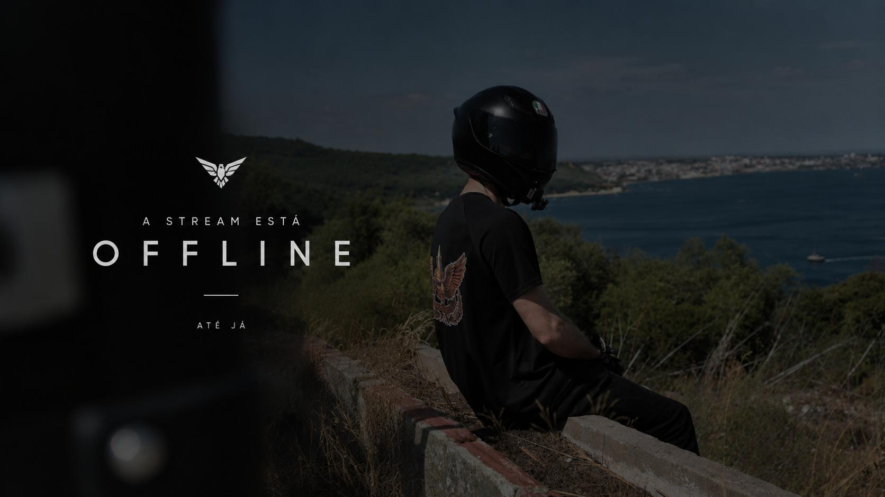
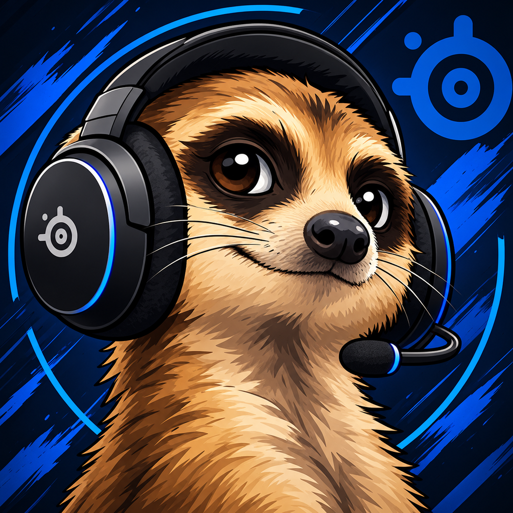

<div align="center">



<br />

# 🦝 SURICATA // DEVELOPER GONE ROGUE

**Former developer. Full-time side quest enthusiast.**  
*Somewhere between a stealth build, an open road and one more game before bed.*

[](https://suricata-projects.github.io/)
[](https://pages.github.com/)
[](https://www.tiktok.com/@suricata.rr)

`[ STATUS: ONLINE ]` · `[ CLASS: ROGUE / PALADIN ]` · `[ LOCATION: PORTUGAL ]`

</div>

---

## 📡 Welcome to my little corner of the internet

I used to write code for a living. Then life dropped a new questline and I decided to follow it.

The developer hasn't disappeared — he's just **gone rogue**.

This website is a digital hideout for the things that make me, well, *me*: late-night gaming sessions, stealthy adventures, questionable memes, horror icons, German lessons, and the occasional escape on two wheels.

> **Main quest:** classified.  
> **Side quests:** aggressively overleveled.  
> **Sleep schedule:** not found.

## 🗂️ Explore the files

| File | Intel |
| :--- | :--- |
| 🎮 **FILE_001 — Shadows & Second Lives** | World of Warcraft, Skyrim, stealth games and the eternal Rogue vs. Paladin dilemma. Nightingale energy included. |
| 🏍️ **FILE_002 — Ride Into the Unknown** | My black **CFMOTO 800MT Explore**, road trips and the freedom of disappearing around the next bend. |
| 🎭 **FILE_003 — After Dark** | Horror, antiheroes, Ghostface, Joker, Scarface and, above all, **Venom**. |
| ☕ **FILE_004 — Side Quests** | Learning German, collecting random interests, coffee, cookies and a healthy dose of internet nonsense. |

## 🛠️ Under the hood

No overengineered framework. No unnecessary build pipeline. Just a small, fast personal website with a cinematic attitude.

- **HTML5** — structure and content
- **CSS3** — responsive layout, animations and blue-neon atmosphere
- **Vanilla JavaScript** — the interactive bits
- **GitHub Pages** — free static hosting and deployment

```text
/
├── index.html      # The main quest
├── style.css       # The drip
├── script.js       # Tiny bits of magic
├── assets/         # Artwork and visual chaos
├── .nojekyll       # Keep GitHub Pages simple
└── README.md       # You are here
```

## 🚀 Run it locally

Clone the repository:

```bash
git clone https://github.com/suricata-projects/suricata-projects.github.io.git
cd suricata-projects.github.io
```

Open `index.html` in your browser. That's it — no dependencies or installation required.

To publish updates, push your changes to `main`. If Pages isn't enabled yet, visit **Settings → Pages → Build and deployment** and select **Deploy from a branch → main → / (root)**.

## 🌐 Find me in the wild

| Platform | Signal |
| :--- | :--- |
| 🌍 Website | [suricata-projects.github.io](https://suricata-projects.github.io/) |
| 🏍️ TikTok | [@suricata.rr](https://www.tiktok.com/@suricata.rr) |
| 🎮 Steam | [itsusername](https://steamcommunity.com/id/itsusername/) |
| 💬 Discord | `itsusername` |
| ⚔️ Battle.net | `Suricata#21238` |
| 🌀 Rift | `itsusername` |

*Steam vanity URL is based on the supplied username; please verify the link before sharing.*

---

<div align="center">

### “I used to write the rules. Now I just explore the map.”



**SURICATA // END OF TRANSMISSION**

<sub>Built with caffeine, late-night ideas and a suspicious number of side quests.</sub>

<br /><br />

<sub>© Suricata. Original site content and artwork remain with their respective owners. Third-party characters, game titles and trademarks belong to their respective rights holders. Code licensing is governed by the repository's LICENSE file, if present.</sub>

</div>

- Replace placeholder social links if your Steam vanity URL differs.
- Artwork provided by the site owner. Third-party characters and marks remain with their respective owners.
- Fonts load from Google Fonts; fallback fonts work offline.

FILE_002 motorcycle image: assets/venom-ride.jpg (user-provided photograph, colour graded).

## Version 5
FILE_001 Nightingale-themed image and FILE_003 blue Ghostface image; original card layout and transitions preserved.
